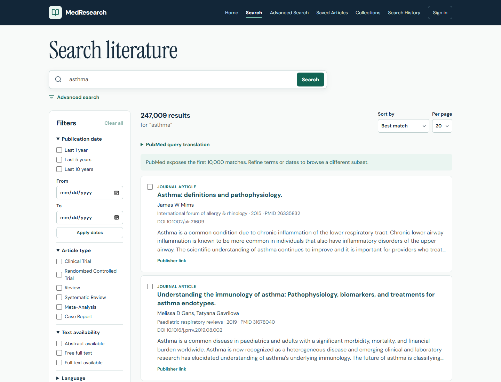

# MedResearch 3.0

[](https://github.com/KateK77/pubmed-clone/actions/workflows/ci.yml)
[](https://github.com/KateK77/pubmed-clone/tree/v3.0.0-r3)

**Search biomedical literature. Keep your research organized. Export citations.**

### [Open MedResearch — 在线使用](https://medresearch-cljd.onrender.com)

Search immediately, or create your own account to save articles and collections. No installation required. 打开网站即可检索；注册自己的账号后可以保存文献和收藏夹。

[Search literature](https://medresearch-cljd.onrender.com/search) · [Sign in / create an account](https://medresearch-cljd.onrender.com/profile) · [100-task final evaluation](evaluation/README.md) · [Deployment](docs/deployment.md)

MedResearch searches live biomedical literature from PubMed and gives researchers a personal library for bookmarks, collections, saved searches, and citation exports. It is an independent educational prototype with no affiliation with PubMed, NCBI, NIH, or the National Library of Medicine.



Built with React, TypeScript and Django. Research records come from the official NCBI E-utilities API. Visitors can search without an account; personal accounts add private bookmarks, collections and saved searches.

Version 3.0 combines the [original specification and all revised requirements](experiments/round-03/description.md) with the owner's [manual testing feedback](experiments/round-03/manual-feedback.json). It simplifies registration, explains the password rule, adds password confirmation and removes unnecessary name fields. It preserves the session fixes, verified email workflow, author suffixes and deployment support from Version 2.0.

**Live website:** [medresearch-cljd.onrender.com](https://medresearch-cljd.onrender.com), hosted on Render Free with persistent PostgreSQL on Neon Free. Registration, session persistence, live PubMed search, citations and private libraries were verified on the public deployment. See the [verification record](docs/public-verification.json).

The free website may take a little longer to open after being idle. Public registration currently works without email verification; verification emails are not enabled. Accounts and collections are stored in the database rather than the web container. Provider usage limits apply.

The repository and its version history are public. To host your own copy, see [deployment instructions](docs/deployment.md) and [`render.yaml`](render.yaml). The following button creates a separate deployment and requires provider accounts:

[](https://render.com/deploy?repo=https://github.com/KateK77/pubmed-clone)

## Features

- Search by keyword, author, title, journal, PMID, DOI, or PubMed field syntax. Combine Boolean groups in the advanced builder and inspect PubMed’s translated query.
- Filter by date, article type, text availability, language, species, MEDLINE, or preprint exclusion. URL parameters preserve filters, sort, and pages.
- Read article metadata, structured abstracts, affiliations, keywords, MeSH descriptors, references, and available similar or citing records. Follow links to PubMed, PMC, and DOI destinations.
- Register, sign in, manage your account email, bookmark articles, manage private collections, and rerun or save searches.
- Verify registration and email changes with single-use email codes when enabled. Keep existing accounts and their libraries through the upgrade. Profile and password changes have separate forms.
- Export selected articles, all bookmarks, or an entire collection in APA, MLA, Vancouver, BibTeX, or RIS. Copy a citation from the article page.

## A quick research walkthrough

| Step | Try it in MedResearch |
| --- | --- |
| Find a publication | Search `31452104` or a research topic such as `electronic health records`. |
| Refine the evidence | Combine dates, article types and other filters, or build a Boolean query in Advanced Search. |
| Read the source | Open a title to inspect its abstract and metadata, then follow its PubMed or publisher link. |
| Keep your work | Create your own account, save an article and organize it in a private collection. |
| Cite your sources | Copy a citation or export selected records or a collection as BibTeX, RIS or a supported text style. |

The public website has no shared demo login. Create an individual account for your library; the local demo credentials below are for local setup only.

## Final evaluation

A dedicated evaluation branch prepares **100 specification-based tasks** from the final V3 Description: **30 Easy, 40 Medium, 20 Hard and 10 Expert**. The intended executor uses OpenAI's native computer tool, sees screenshots, and chooses mouse and keyboard actions. Existing CI and earlier Playwright checks are separate evidence and do not count toward this benchmark.

**Native CUA execution has not started; no final pass rate is available.** Paid execution requires explicit budget approval. Missing features remain test targets, and each result will distinguish PASS, FAIL, BLOCKED, ERROR and NOT_RUN.

[Evaluation showcase](evaluation/README.md) · [All 100 tasks](evaluation/FINAL_TEST_CASES.md) · [Results and evidence](evaluation/FINAL_EVALUATION_REPORT.md) · [Cost and execution plan](evaluation/EXECUTION_PLAN.md) · [Frozen specification](evaluation/SPECIFICATION.md)

These evaluation and presentation changes remain on `evaluation/v3-native-cua-100` until the owner approves a merge into `main`.

## Accounts

New passwords use **8–128 characters**. Uppercase letters, digits and symbols are optional. There is no hidden common-password or username-similarity restriction. The rule appears below the password field before you submit. Registration and password changes require a matching **Confirm password** in both the browser and API. Existing accounts sign in with their current password and do not need to register again.

Successful registration or ordinary sign-in opens Search. When a library or article page asks you to sign in, you return to that page with its URL state. Account settings contain username, email, password change and sign out. First name and Last name are no longer shown or required. Existing stored names are preserved for compatibility. The same-user email draft recovery remains available if a session expires while editing email.

For API clients, send `password_confirmation` alongside `password` to `/api/auth/register/`, and when changing a password with `PATCH /api/profile/`. Login and email-only updates do not need confirmation. API schema is available at `/api/schema/`.

## Architecture

React, TypeScript, Vite, Tailwind CSS, React Router, and TanStack Query provide the browser interface. Django REST Framework exposes session and literature APIs. The NCBI service sends ESearch queries, fetches ordered batches via EFetch, and loads ELink relationships with ESummary. Django persists accounts and library records in SQLite locally or PostgreSQL in production. See [architecture](docs/architecture.md) for the data model and operating details.

## Run locally

Install Python 3.12+ and Node.js 22.12+ with npm. Open PowerShell in the folder containing this README, `backend` and `frontend`. The path is the cloned project folder, not your Windows home directory.

```powershell
.\start.ps1 -Service setup
```

Then run these commands in two separate PowerShell windows in that folder:

```powershell
.\start.ps1 -Service backend
```

```powershell
.\start.ps1 -Service frontend
```

The script also accepts an absolute path and resolves project files from its own location. If script execution is disabled, the equivalent manual setup is:

```powershell
python -m venv .venv
.\.venv\Scripts\python -m pip install -r backend/requirements.txt
Copy-Item .env.example .env
.\.venv\Scripts\python backend/manage.py migrate
.\.venv\Scripts\python backend/manage.py create_demo
.\.venv\Scripts\python backend/manage.py runserver 127.0.0.1:8014
```

In another terminal:

```powershell
npm.cmd --prefix frontend ci
npm.cmd --prefix frontend run dev
```

Open [MedResearch](http://127.0.0.1:5184). On Linux or macOS, use `.venv/bin/python`, `cp`, and `npm`. Use the same browser hostname throughout the session.

The local demo account is `medresearch-demo` with password `LocalResearchDemo!26`. The seed command runs in development mode and leaves an existing demo password intact.

The example configuration disables mandatory email verification for local testing. With verification enabled, users must supply an email and a code, and registration remains unavailable until an email backend is configured. Production should use SMTP. Existing users can still log in and verify their email from Profile. No SMTP credential or test message is committed to this repository.

### Upgrade from an earlier version

Back up the database, install the updated dependencies, run `python backend/manage.py migrate`, rebuild the frontend and restart both services. Do not replace an existing `.env` with the example. Add the email settings below explicitly. Version 3.0 requires no new database migration and preserves accounts, saved articles and collections. If upgrading from Round 1, sign in again because the session cookie changed in Version 2.0. Legacy saved article metadata is refreshed from PubMed when opened or exported, preserving author suffixes such as `Jr`.

## Configuration

| Variable | Purpose |
| --- | --- |
| `DJANGO_DEBUG` | Set `0` in production. Default `1`. |
| `DJANGO_SECRET_KEY` | Set a strong unique secret in production. |
| `DJANGO_ALLOWED_HOSTS` | Comma-separated Django hosts. |
| `DJANGO_TRUST_PROXY` | Set `1` only behind a trusted HTTPS proxy that overwrites `X-Forwarded-Proto`. |
| `DJANGO_CSRF_TRUSTED_ORIGINS` | Comma-separated HTTPS origins, including the public website origin. |
| `DJANGO_HSTS_SECONDS` | HTTPS strict transport duration. Production default 3600. |
| `DJANGO_CACHE_TABLE` | Optional database-backed Django cache. Run `python backend/manage.py createcachetable` after configuring it. |
| `NCBI_EMAIL` | Operator contact sent to NCBI. Set for shared deployments. |
| `NCBI_API_KEY` | Optional server-side NCBI credential. |
| `NCBI_CACHE_SECONDS` | E-utilities cache TTL. Default 900. |
| `POSTGRES_DB`, `POSTGRES_USER`, `POSTGRES_PASSWORD`, `POSTGRES_HOST`, `POSTGRES_PORT` | PostgreSQL connection settings. Setting the database name enables PostgreSQL. |
| `POSTGRES_SSLMODE` | PostgreSQL TLS mode. Use the value required by the database provider. |
| `DATABASE_URL` | Hosted PostgreSQL URL, such as Neon's connection string. Overrides `POSTGRES_*`. TLS defaults to `require`. Keep this in hosting secrets. |
| `EMAIL_VERIFICATION_REQUIRED` | Default `1`. The development example sets `0`. |
| `EMAIL_HOST`, `EMAIL_PORT`, `EMAIL_HOST_USER`, `EMAIL_HOST_PASSWORD`, `DEFAULT_FROM_EMAIL` | SMTP server, authentication and verified sender settings. |
| `EMAIL_USE_TLS`, `EMAIL_USE_SSL` | Enable the transport required by the email provider. Do not enable both. |
| `MEDRESEARCH_API_TARGET` | Optional Vite proxy target. Default `http://127.0.0.1:8014`. |

Build with `npm --prefix frontend run build`. The WSGI application serves the built frontend and `/api/` from one origin, including frontend route refreshes. The Dockerfile packages both. Apply migrations before starting the container. Use one application process to keep the built-in NCBI limiter within its quota. The generated OpenAPI schema is available at `/api/schema/`. `/api/health/` checks database connectivity. See [deployment](docs/deployment.md) for HTTPS, PostgreSQL, SMTP and GitHub link setup.

## Tests

```text
python -m pytest -q
python backend/manage.py check
python backend/manage.py makemigrations --check --dry-run
python backend/manage.py spectacular --validate --file openapi.yaml
npm --prefix frontend test
npm --prefix frontend run build
python tests/deployment_smoke.py
cd frontend
npx playwright install chromium
cd ..
npm --prefix frontend run e2e
python tests/live_smoke.py
```

Pytest and Vitest use deterministic fixtures. Playwright covers desktop and mobile discovery with fixture responses, plus real Django registration, verification, profile persistence, expired sessions and account isolation. Its temporary SQLite database and file-based test mailbox are separate from your local data. Set `MEDRESEARCH_TEST_PYTHON` to your virtual environment's Python path if `python` resolves elsewhere. The live smoke test contacts NCBI.

For manual validation, register with a password meeting the visible length rule and confirm it. Try a mismatch first and verify the explanation. After registration, check that Search opens. Visit Account and verify there are no name fields. Update an email using verification when enabled, reload, and sign in again to verify persistence. Sign out, open Saved Articles, follow its sign-in link and confirm you return there after login. Search `31452104`, inspect the author suffix `Jr`, citations and related articles. Search `asthma`, apply Review and a date filter, go to the next page, then use Back. Save an article, create a collection and export RIS. Use a second account to check that the first account's collection URL is inaccessible.

## Limits

- PubMed reports the complete count and exposes the first 10,000 results per query for pagination.
- Related and cited-by panels show up to eight records per relationship, subject to what ELink returns. Full-text links are derived from PMC IDs and DOI metadata. Publisher availability varies.
- Citations are plain-text renderings and bibliographic exports. Metadata availability determines which fields can be included. Dedicated selected-ID exports accept up to 200 PMIDs per request.
- Search history shows the most recent 500 entries. The bundled limiter is process-local. A shared multi-process deployment needs centralized request pacing.
- Clinical interpretation and treatment decisions are outside the prototype’s scope.
